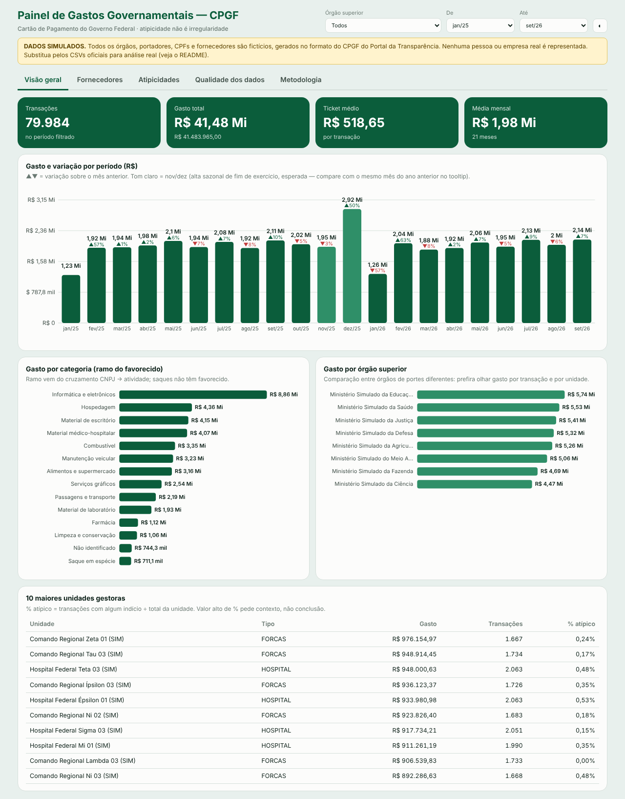
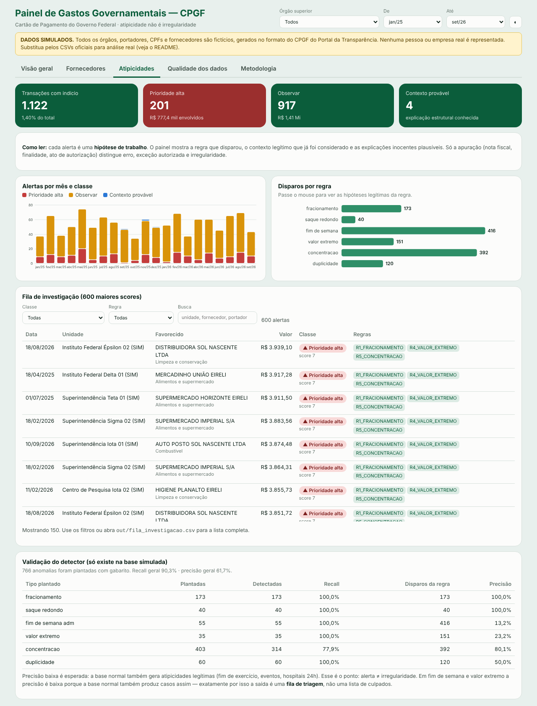

# Dashboard de Gastos Governamentais — CPGF

Análise de gastos do **Cartão de Pagamento do Governo Federal (CPGF)** para responder:

> **Como identificar padrões de gastos públicos, despesas atípicas e oportunidades de fiscalização — sem confundir anomalia com irregularidade?**

**Ferramentas:** SQL Server · Python (pandas) · Power BI · painel web (HTML)


📄 **[Relatório completo do projeto](docs/RELATORIO.md)** — passo a passo, 14 problemas reais resolvidos e validação.




> ⚠️ **Os dados deste repositório são SIMULADOS.** Órgãos, portadores, CPFs e fornecedores são fictícios, gerados no
> **formato** do CPGF do Portal da Transparência (separador `;`, ISO-8859-1, decimal com vírgula, CPF mascarado,
> favorecido sigiloso, estornos, duplicidades, mês de extrato ≠ mês da transação). Nenhum número aqui descreve gasto real.
> Para análise real, troque pelos CSVs oficiais (seção “Usar dados reais”).

## Diferencial: atipicidade ≠ irregularidade
Cada regra marca uma **atipicidade** e vem acompanhada de:
1. **Peso** (quão forte é o indício);
2. **Contexto legítimo** que reduz o score (fim de exercício, unidade que opera 24h, evento anual);
3. **Hipóteses inocentes plausíveis** (mostradas em cada alerta);
4. **Classe de triagem**: `prioridade alta` · `observar` · `contexto provável`.

A saída é uma **fila de investigação**, não uma lista de culpados.

| Regra | O que detecta | Explicações legítimas (exemplos) |
|---|---|---|
| R1 Fracionamento | ≥3 compras no mesmo dia, mesmo portador+fornecedor, todas logo abaixo do limite | reposição recorrente, limite do cartão |
| R2 Saque redondo | saque ≥ R$ 1.500 e múltiplo de 100 | pronto pagamento autorizado |
| R3 Fim de semana | compra em sáb/dom em unidade que **não** opera 24h | plantão, evento, data de processamento |
| R4 Valor extremo | valor muito acima do típico do ramo (mediana/MAD em log) | equipamento pontual, erro de digitação |
| R5 Concentração | um fornecedor > 35% do gasto mensal da unidade | ata de registro de preços, fornecedor único |
| R6 Duplicidade | mesmo portador+fornecedor+valor+dia | erro de carga **ou** compras idênticas |

## Resultados na base simulada
- 79.984 transações · R$ 41,48 mi · 60 unidades · 408 fornecedores
- 1.122 transações com indício (1,40%); **201 prioridade alta** (R$ 777 mil)
- Nov/dez gastam ~26% acima dos outros meses → tratado como **sazonalidade**, não anomalia
- 8.868 compras em fim de semana em hospitais/forças **não** viraram alerta (contexto aplicado)
- **Validação com gabarito** (766 anomalias plantadas): recall 90,3% · precisão 61,7%. Fracionamento e saque redondo: 100%/100%. Fim de semana e valor extremo têm precisão baixa **de propósito visível**: a base normal também gera casos assim, por isso o resultado é triagem.

## Estrutura
```
data/raw/            CSVs (simulados) + dimensões de contexto + gabarito
src/
  gerar_dados_simulados.py   gera a base fictícia (seed fixa, reprodutível)
  analise_cpgf.py            limpeza → regras → score → agregados + validação
  build_dashboard.py         injeta os dados no template HTML
  gerar_diagrama.py          gera docs/diagrama_pipeline.svg/png
sql/
  01_schema_e_carga.sql      stg (bruto) + dimensões + tabela de parâmetros
  02_tratamento.sql          tipagem, flags, índices, relatório de qualidade
  03_analises.sql            período, categoria, fornecedor (ABC), faixas de valor, unidade
  04_anomalias.sql           6 regras em T-SQL + score + classe + fila
dashboard/index.html         painel web (abre offline)
docs/                        relatório, diagrama e capturas do painel
powerbi/GUIA_POWER_BI.md     modelo, Power Query, medidas DAX, páginas
out/                         dashboard_data.json, fila_investigacao.csv
```

## Como rodar
```bash
pip install -r requirements.txt
python src/gerar_dados_simulados.py     # gera data/raw/*
python src/analise_cpgf.py              # gera out/*
python src/build_dashboard.py           # gera dashboard/index.html
```
SQL Server: execute `sql/01` → `04` em ordem (ajuste o caminho dos CSVs no `BULK INSERT`).
Power BI: siga `powerbi/GUIA_POWER_BI.md`.

> Os scripts SQL foram escritos para SQL Server 2019+ (`CONCAT_WS`, `PERCENTILE_CONT`, `TRY_CONVERT`), mas **não foram executados**
> no ambiente onde o projeto foi gerado. Rode, confira contagens contra `out/` (Python) e reporte divergências.

## Usar dados reais
1. Baixe os arquivos mensais em *portaldatransparencia.gov.br → Download de dados → Cartão de Pagamento do Governo Federal*.
2. `python src/analise_cpgf.py --entrada data/raw/202501_CPGF.csv --entrada data/raw/202502_CPGF.csv ...`
3. Confira se os cabeçalhos batem com os de `analise_cpgf.py` (o portal pode mudar nomes/acentos).
4. Forneça as dimensões de contexto (sem elas o ramo vira “Não identificado”):
   - `dim_favorecido_ramo.csv`: `cnpj_favorecido;nome_favorecido;ramo_atividade` (CNPJ → CNAE, dados abertos da Receita)
   - `dim_unidade_contexto.csv`: `cod_unidade_gestora;tipo_unidade;opera_24h`
   - `dim_eventos_legitimos.csv`: `cod_unidade_gestora;mes;motivo` (pode ficar só com cabeçalho)
5. Ajuste os parâmetros (`P` no Python / tabela `dbo.parametros` no SQL), em especial `limite_unitario`, conforme a norma vigente.

## Limites
- A base pública não traz nota fiscal, finalidade nem ato de autorização: o painel gera **hipóteses**.
- Sem ID da transação, “duplicidade” não distingue erro de carga de compra repetida.
- Favorecido sigiloso e saques ficam sem categoria.
- Regras e pesos são ponto de partida; calibre com quem conhece a rotina dos órgãos.

## Licença
MIT — veja [LICENSE](LICENSE).
