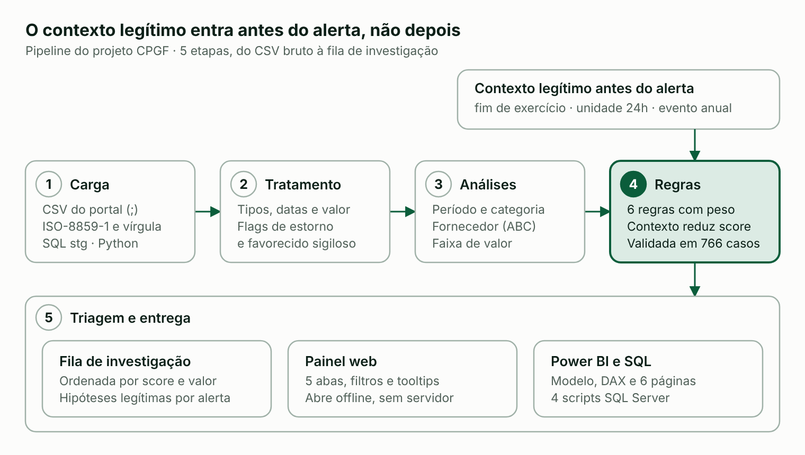

# Relatório do Projeto — Dashboard de Gastos Governamentais (CPGF)

> **Dados simulados.** O Portal da Transparência estava inacessível no ambiente de desenvolvimento (erro 403). Todos os números vêm de uma base fictícia no formato oficial do CPGF. O código aceita os CSVs oficiais sem alteração.

## Resumo

O projeto entrega um pipeline completo de análise do CPGF que separa **atipicidade** de **irregularidade**: 79.984 transações (R$ 41,48 mi) viraram uma fila de 201 itens de prioridade alta (R$ 777,4 mil), cada um com a regra que disparou e as explicações legítimas possíveis.

- **Entregáveis:** painel web interativo, 4 scripts SQL Server, pipeline Python, guia Power BI (modelo, Power Query, DAX) e README.
- **Base de teste:** 60 unidades gestoras, 8 órgãos superiores, 408 fornecedores, jan/2025 a set/2026, com 766 anomalias plantadas e gabarito.
- **Resultado do detector:** recall de 90,3% e precisão de 61,7% sobre as anomalias plantadas.

## Passo a passo do projeto

Cada etapa existe em SQL Server e em Python; o contexto legítimo reduz o score antes de o item entrar na fila.

## Problemas reais resolvidos

Treze problemas apareceram no caminho; os seis primeiros são da própria base do CPGF e valem também para os arquivos oficiais.

| # | Problema | Impacto medido | Solução adotada | Resultado |
|---|---|---|---|---|
| 1 | Mês do extrato diferente do mês da transação | 23.565 linhas (29,5%) | Análise temporal usa a data da transação, não o extrato | Série mensal coerente com o gasto real |
| 2 | Favorecido sigiloso ou sem informação | 1.494 sigilosos e 2.559 sem informação | Fora do ranking de fornecedores e da regra de concentração | Ranking não é distorcido por quem não dá para identificar |
| 3 | Estornos (valor negativo) | 601 linhas | Mantidos no gasto líquido, excluídos das regras de compra | Estorno não vira "compra atípica" |
| 4 | Linhas repetidas sem ID da transação | 60 linhas idênticas | Sinalizadas, nunca removidas | Não se apaga compra legítima repetida |
| 5 | Formato do arquivo: ISO-8859-1, `;` e vírgula decimal | 100% das linhas | Leitura como texto e conversão controlada de valor e data | 0 valores e 0 datas inválidos em 79.984 linhas |
| 6 | Saques sem favorecido | 1.949 saques (R$ 711 mil) | Categoria própria e regra de saque redondo | Saque analisado à parte |
| 7 | Fim de exercício parecia crescimento anormal | Nov/dez 26,3% acima dos outros meses; dez +50% sobre nov | Tom destacado no gráfico e comparação com o mesmo mês do ano anterior | Sazonalidade deixou de ser lida como anomalia |
| 8 | Falsos positivos em hospitais e forças | 8.868 compras de fim de semana | Unidade que opera 24h entra como contexto, antes do alerta | Nenhuma gerou alerta de fim de semana |
| 9 | Regra de valor extremo ruidosa | 929 disparos, 3,8% de precisão | Desvio robusto em escala logarítmica (mediana e MAD) por ramo | 151 disparos, 23,2% de precisão, 100% das plantadas |
| 10 | Portal da Transparência inacessível (403) | Sem dado oficial | Base simulada no formato real, semente fixa e gabarito | Detector medido contra 766 anomalias conhecidas |
| 11 | SQL com agrupamento errado e dependência de configuração | View de ramo agrupava por valor; fim de semana dependia de DATEFIRST | Mediana por ramo em CTE; fórmula independente de DATEFIRST; parâmetros em tabela | Regras iguais em qualquer servidor |
| 12 | Gráfico mensal com rótulos sobrepostos e eixo cortado | Visto na renderização | Escala do desenho refeita e conferida por captura de tela | Leitura limpa em 21 meses |
| 13 | Erro de tipo no pandas ao preencher o ramo | Pipeline parava | Preenchimento por série alinhada ao índice | Pipeline roda de ponta a ponta |

Um 14º ajuste veio da revisão final: itens "contexto provável" com score zerado ficavam fora da contagem de atípicos (1.120 em vez de 1.122). A classe passou a definir o que é atípico.

## Atipicidade não é irregularidade

Cada regra aponta um padrão que merece contexto; só a apuração documental (nota fiscal, finalidade, ato de autorização) distingue erro, exceção autorizada e irregularidade.

| Regra | Peso | O que detecta | Explicações legítimas |
|---|---|---|---|
| R1 Fracionamento | 3 | 3 ou mais compras no mesmo dia, mesmo portador e fornecedor, todas logo abaixo do limite | Reposição recorrente; limite do cartão no dia |
| R2 Saque redondo | 2 | Saque de R$ 1.500 ou mais, múltiplo de 100 | Pronto pagamento autorizado |
| R4 Valor extremo | 2 | Valor muito acima do típico do ramo (mediana e MAD em log) | Equipamento pontual; erro de digitação |
| R5 Concentração | 2 | Um fornecedor com mais de 35% do gasto mensal da unidade | Ata de registro de preços; fornecedor único |
| R3 Fim de semana | 1 | Compra em sábado ou domingo em unidade que não opera 24h | Plantão; evento; data de processamento |
| R6 Duplicidade | 1 | Mesmo portador, fornecedor, valor e dia | Erro de carga ou compra idêntica legítima |

O contexto estrutural (fim de exercício, evento anual cadastrado, unidade 24h) reduz o score em 2 pontos antes da triagem:

- **Prioridade alta:** score 3 ou mais depois do ajuste. 201 transações, R$ 777,4 mil.
- **Observar:** score 1 ou 2. 917 transações.
- **Contexto provável:** havia indício, mas existe explicação estrutural conhecida. 4 transações.

Títulos e cores do painel evitam "fraude" e "irregular": vermelho só para prioridade alta, sempre com ícone e rótulo.

## Validação do detector

Com 766 anomalias plantadas, o detector acerta 90,3% (recall) e 61,7% do que sinaliza é plantado (precisão). A precisão baixa em duas regras é esperada: a base normal também produz fins de semana e valores altos legítimos, por isso a saída é uma fila de triagem.

| Tipo plantado | Plantadas | Detectadas | Recall | Disparos da regra | Precisão |
|---|---|---|---|---|---|
| Fracionamento | 173 | 173 | 100,0% | 173 | 100,0% |
| Saque redondo | 40 | 40 | 100,0% | 40 | 100,0% |
| Concentração | 403 | 314 | 77,9% | 392 | 80,1% |
| Duplicidade | 60 | 60 | 100,0% | 120 | 50,0% |
| Valor extremo | 35 | 35 | 100,0% | 151 | 23,2% |
| Fim de semana (administrativa) | 55 | 55 | 100,0% | 416 | 13,2% |

A correção da regra de valor extremo (problema 9) subiu a precisão geral de 41,7% para 61,7% ao custo de 2,9 pontos de recall (de 93,2% para 90,3%).

## Limites e próximos passos

**Limites**

- Os scripts SQL foram escritos para SQL Server 2019 ou superior, mas não foram executados no ambiente de desenvolvimento; as contagens precisam ser conferidas contra a saída em Python.
- A base pública não traz nota fiscal, finalidade nem autorização: o painel gera hipóteses, não provas.
- Sem ID da transação, duplicidade não distingue erro de carga de compra repetida.
- A regra de concentração recupera 77,9% das plantadas; a de pico mensal por unidade não foi implementada.
- O arquivo do Power BI (.pbix) não foi gerado; há um guia com modelo, Power Query e medidas DAX.

**Próximos passos**

1. Baixar os CSVs mensais do Portal da Transparência e rodar o pipeline com `--entrada`.
2. Montar a dimensão de ramo (CNPJ para CNAE) e a de contexto das unidades.
3. Ajustar o limite por compra à norma vigente e calibrar pesos com quem conhece a rotina dos órgãos.
4. Executar os scripts SQL e comparar as contagens com o Python.
5. Montar o .pbix seguindo o guia e publicar o repositório no GitHub.
